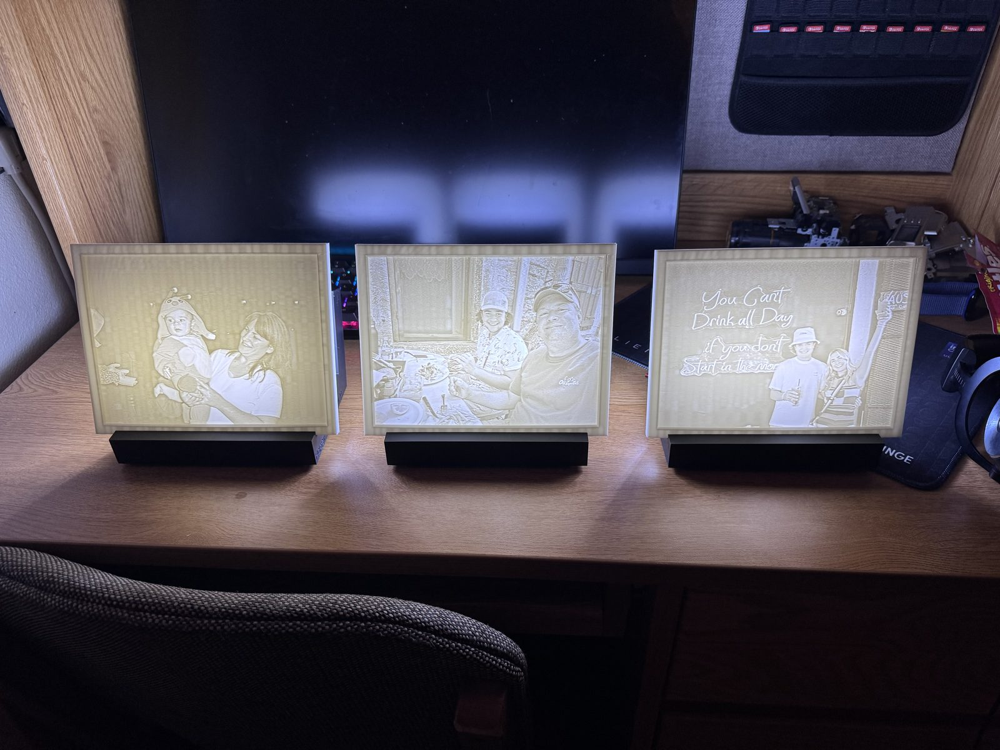

# Lithophane Light Box

Battery-powered light boxes for displaying 3D-printed lithophanes, built as handmade holiday gifts.
A lithophane is a thin print that shows a photo when it's lit from behind; this board provides
an even backlight from a row of LEDs, and a 3D-printed base hides the board, battery pack and switch.

## The board

A two-layer, all through-hole PCB designed in KiCad so it can be soldered by hand.

| Qty | Part | Footprint |
| --- | --- | --- |
| 25 | 5 mm LED | LED_D5.0mm |
| 25 | 300 Ω resistor (one per LED) | Axial, DIN0207 |
| 1 | 2-pin header, for the battery pack and switch | 2.54 mm pitch |

## Files

| Folder | Contents |
| --- | --- |
| `kicad/` | KiCad project, schematic and PCB layout |
| `fabrication/` | Gerbers, drill files, BOM and pick-and-place files as sent to PCBWay |

## Ordering a board

Upload `fabrication/lithophaneLED-gerbers-PCBWay.zip` to PCBWay or any other PCB manufacturer.

## Author

Dillon Michlena · [GitHub](https://github.com/dillp1)
